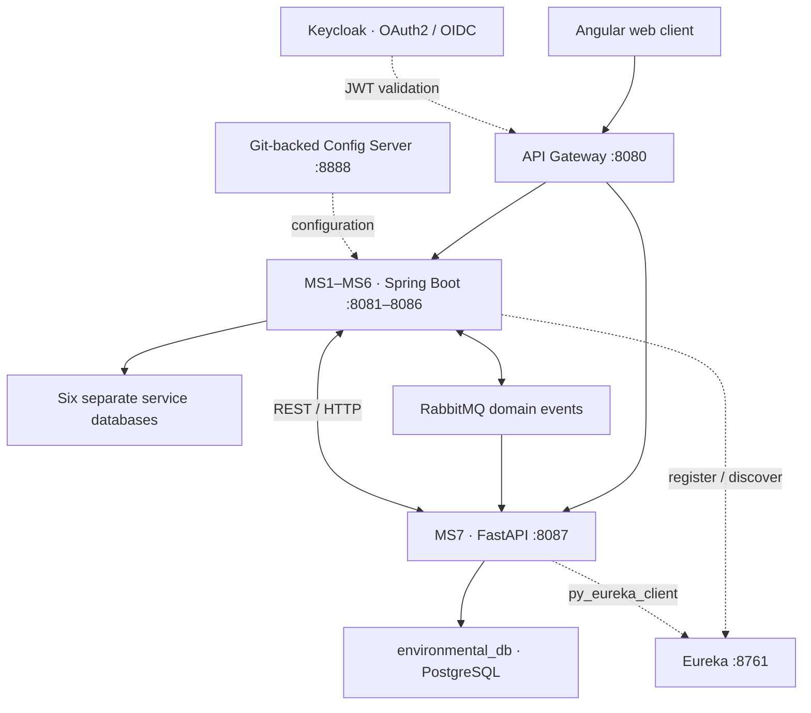

# WattWise TN

**Smart & sustainable energy platform for Tunisian households.**

WattWise TN helps households understand electricity use, estimate STEG bills, monitor rooftop solar, reduce waste, join saving challenges, report outages and measure environmental impact. It connects practical household decisions with environmental protection in Tunisia.

An ESPRIT **Distributed Web Applications (AWD / MT-41)** project · **4DAS** · **2026–2027** · Dr. Badia Bouhdid.

> **Current status — Session 4, Intermediate Validation 1:** repository organization and documentation placeholders. Application projects, databases, infrastructure and business endpoints are not implemented by this scaffold. The target design below follows [WATTWISE_CONTEXT.md](WATTWISE_CONTEXT.md).

## Who uses it?

- **Household Owner:** manages the household, members, meters, appliances, readings, solar installations, saving plans and sustainability reports.
- **Household Member:** views consumption, joins challenges, reports outages and views community sustainability.
- **Administrator:** manages platform settings and emission factors and oversees data integrity.

For example, a household records meter readings, sees an estimated bill, tracks solar production and joins a saving challenge. Its environmental report explains avoided emissions while preventing double counting between reduced grid consumption and solar self-consumption. Billing and carbon outputs are estimates, with assumptions and data sources to be documented.

## Repository structure

```text
AWD/
├── README.md
├── WATTWISE_CONTEXT.md
├── docker-compose.yml              # Explicit placeholder; infrastructure pending
├── Documentation/
│   ├── Technical-Document/
│   ├── Diagrams/
│   │   ├── architecture/
│   │   ├── use-case/
│   │   ├── class-diagrams/
│   │   └── sequence/
│   └── Presentation/
├── Frontend/
│   ├── web/                       # Angular; one feature module per service
│   └── mobile/                    # Optional future client
└── Backend/
    ├── api-gateway/
    ├── discovery-service/
    ├── config-server/
    ├── ms1-household-service/
    ├── ms2-consumption-service/
    ├── ms3-solar-service/
    ├── ms4-challenge-service/
    ├── ms5-optimization-service/
    ├── ms6-outage-service/
    └── ms7-environmental-service/
```

Each backend folder has a concise handoff README. Empty diagram folders contain `.gitkeep`; actual images, presentation exports and the technical document still need to be supplied.

## Seven business microservices

Six students own one Spring Boot service each. MS7 is a shared FastAPI service; the gateway, discovery and configuration components are infrastructure and do not count toward the seven.

| Service / folder | Owner | Port | Dedicated database | Responsibility |
|---|---|---|---|---|
| [MS1 Household Management](Backend/ms1-household-service/) | Yesmina | 8081 | PostgreSQL `household_db` | Households, members, electricity meters, appliances and household energy profiles. |
| [MS2 Consumption & Bills](Backend/ms2-consumption-service/) | Ryma | 8082 | MySQL `consumption_db` | Meter readings, consumption history, STEG bill estimates and forecasts. |
| [MS3 Solar Management](Backend/ms3-solar-service/) | Farouk | 8083 | PostgreSQL `solar_db` | Solar installations, panels, production, self-consumption, exports and estimated savings. |
| [MS4 Challenges & Rewards](Backend/ms4-challenge-service/) | Arfaoui | 8084 | MongoDB `challenge_db` | Energy-saving challenges, participation, progress, points, badges and leaderboards. |
| [MS5 Smart Optimization](Backend/ms5-optimization-service/) | Selim | 8085 | MongoDB `optimization_db` | Consumption analysis, anomalies, efficiency scores, personalized recommendations, simulations and saving plans. |
| [MS6 Outage Analysis](Backend/ms6-outage-service/) | Mahdi | 8086 | MongoDB `outage_db` | GPS outage reports, incident clustering and area reliability metrics. |
| [MS7 Environmental Impact](Backend/ms7-environmental-service/) | Whole team (presented by Selim) | 8087 | PostgreSQL `environmental_db` | Carbon footprint, avoided emissions without double counting, community statistics and sustainability reports. |

**One database per service, never shared.** Services exchange identifiers and API responses or domain events; they do not query another service's tables or collections.

PostgreSQL supports MS1's household relationships and integrity, MS3's relational solar data and precise numeric values, and MS7's monthly reporting. MySQL supports transactional readings and tiered billing in MS2. MongoDB supports flexible challenge/recommendation documents in MS4–MS5 and GeoJSON/2dsphere outage queries in MS6.

## Target architecture



The Angular client sends application API traffic only through the gateway. The gateway checks Keycloak JWTs. Every business service, including MS7, registers with Eureka. Java synchronous clients use OpenFeign with Resilience4j circuit breakers and fallbacks; MS7 uses Python HTTP clients. RabbitMQ carries asynchronous domain events. The deployment target is Docker Compose.

| Platform component | Technology | Port | Owner |
|---|---|---|---|
| API Gateway | Spring Cloud Gateway | 8080 | Farouk |
| Discovery | Netflix Eureka | 8761 | Farouk |
| Configuration | Spring Cloud Config Server, Git-backed | 8888 | Farouk |

Keycloak, RabbitMQ and database connection ports are to be configured in the infrastructure implementation; this scaffold does not assign additional ports.

### Synchronous communication

| Caller → dependency | Purpose |
|---|---|
| MS2 → MS1 | Validate meter ownership |
| MS3 → MS1 | Validate household existence |
| MS5 → MS2, MS3 | Retrieve consumption history and solar data |
| MS7 → MS1, MS2, MS3 | Retrieve report data |

When MS1 is unavailable, MS2 refuses unvalidated readings with 503 or marks them pending validation; MS3 rejects new installations with 503 while existing reads remain available. MS5 falls back to generic recommendations using the household appliance profile; MS7 falls back to a stored environmental baseline when MS2 is unavailable. MS4 and MS6 have no synchronous business dependencies. Detailed contracts and failure behavior remain in the project context.

### Asynchronous communication

| Event | Publisher | Consumer / purpose |
|---|---|---|
| `ApplianceAdded` | MS1 | MS5: refresh profile |
| `ConsumptionCalculated` | MS2 | MS4: challenge progress; MS7: emissions |
| `SolarProductionRecorded` | MS3 | MS7: avoided emissions |
| `OutageIncidentUpdated` | MS6 | Community alerts in later sessions |

Consumers can process queued events after recovery. Durable queues, acknowledgements, retries and duplicate handling must be configured during implementation.

## Technology choices

| Area | Agreed technology |
|---|---|
| Web | Angular |
| MS1–MS6 | Java 17, Spring Boot 3.3.x, Maven |
| Java naming | Group `tn.esprit.wattwise`; packages `tn.esprit.wattwise.<domain>` |
| MS7 | Python, FastAPI, Uvicorn, `py_eureka_client` |
| API documentation | OpenAPI; springdoc 2.6.0 for Spring, FastAPI `/docs` |
| Service platform | Spring Cloud Gateway, Eureka, Spring Cloud Config |
| Authentication | Keycloak, OAuth2 / OIDC, JWT |
| Communication | OpenFeign, Resilience4j, RabbitMQ |
| Persistence | PostgreSQL, MySQL, MongoDB; isolated databases |
| Deployment | Docker and Docker Compose |
| Planning | Jira, or Trello if selected consistently by the team; board link pending |

## Team responsibilities

| Member | Individual service | Shared responsibility |
|---|---|---|
| Yesmina | MS1 Household | Problem statement, actors and use cases |
| Ryma | MS2 Consumption | Decomposition and Angular frontend setup |
| Farouk | MS3 Solar | Gateway, Eureka, Config, Docker Compose and architecture diagram |
| Arfaoui | MS4 Challenges | Class diagrams and technical document assembly |
| Selim | MS5 Optimization | Sync/async communication, MS7 lead and presentation |
| Mahdi | MS6 Outage | Git repository, README, planning board and Blackboard submission |

Every member must make **at least one personal commit to MS7**, in addition to their own service commits. These scaffold commits do not replace individual implementation contributions. Each student presents their own service; Selim presents shared MS7.

## Getting started

### Available now

Clone and inspect the repository:

```bash
git clone https://github.com/mahdibenmansour/AWD.git
cd AWD
```

Read the [project context](WATTWISE_CONTEXT.md) and your service README before implementing. There is currently no runnable application; the Compose file contains no services.

### Implementation handoff

1. Farouk implements Eureka, the gateway, Git-backed Config Server and Compose infrastructure with all seven isolated databases.
2. Each owner creates their Java 17 / Spring Boot 3.3.x Maven project using the exact folder/service name, port and database above.
3. Selim initializes MS7 in FastAPI with Uvicorn, OpenAPI and Eureka registration; every member contributes.
4. Ryma initializes Angular under `Frontend/web`, with feature modules aligned to the seven domains.
5. Owners document and verify their service before adding later-session business logic.

Required tools for that phase are Git, JDK 17, Maven (or the project wrapper), Docker with Compose, Python and an Angular-compatible Node.js/npm version. Exact Python, Angular/Node and Spring Cloud versions must be recorded when selected.

Once the corresponding applications and configuration exist, the intended local workflow is:

```bash
# Repository root, after Farouk implements Compose:
docker compose up -d

# Each Java project, after its pom.xml exists:
mvn spring-boot:run

# Backend/ms7-environmental-service, after requirements.txt and main.py exist:
python -m pip install -r requirements.txt
python -m uvicorn main:app --port 8087 --reload

# Frontend/web, after Angular initialization:
npm install
npm start
```

Start supporting infrastructure, then Config/Eureka, then business services and the gateway. Use the implemented frontend's documented start command. Keep credentials in local environment configuration, never in commits.

### Session 4 verification target

For each service, implement **only a basic working example**, not business logic:

- `GET /api/v1/hello` on the assigned port returns the service name and an UP status.
- Java Swagger is reachable at `http://localhost:<port>/swagger-ui.html`; MS7 docs at `http://localhost:8087/docs`.
- All seven services appear in Eureka at `http://localhost:8761`.
- The project compiles/starts with its own database configuration.
- The owner contributes a personal commit and can explain entities, endpoints/status codes, interactions and dependency failures.

Business APIs use the `/api/v1` prefix. The full agreed endpoints, entities and event names are preserved in [WATTWISE_CONTEXT.md](WATTWISE_CONTEXT.md).

## Documentation and milestones

- [Technical document](Documentation/Technical-Document/): topic, actors, decomposition, entities, communication, architecture, technologies, responsibilities, schedule and risks.
- [Diagrams](Documentation/Diagrams/): global architecture, use cases, seven class diagrams and sequence diagrams.
- [Presentation](Documentation/Presentation/): Session 4 PPTX/PDF, 10–15 minutes plus questions.
- Blackboard package: repository link, technical document, presentation and architecture diagram.

| Phase | Planned focus |
|---|---|
| S4 | Design validation, repository organization, service skeletons and hello endpoints |
| S5–S6 | Entities, databases and REST APIs |
| S7 | Gateway routes, OpenFeign and Resilience4j |
| S8 | RabbitMQ domain events |
| S9 | Keycloak security |
| S10 | Docker deployment, frontend integration and final demo |

The schedule is provisional. Prototype FastAPI/Eureka/RabbitMQ integration early, protect synchronous dependencies, coordinate container configuration and review personal contributions regularly. Environmental factors need documented sources and validity dates; the context's 0.45 kg CO₂e/kWh is a provisional design default, not a verified official factor.

## Collaboration

Pull the latest changes before starting. Work in your assigned service folder; coordinate changes to shared infrastructure, documentation and MS7. Use your own GitHub account and clear messages such as `feat(ms2): add hello endpoint`. Prefer focused branches and reviewed changes.

Still to complete: group number, planning-board link, teacher collaborator access, runnable projects, infrastructure, presentation exports and diagrams. Teacher access is a team setup task and has not been changed by this scaffold.
